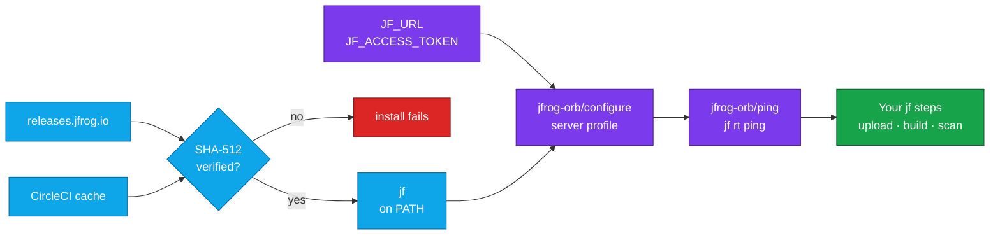
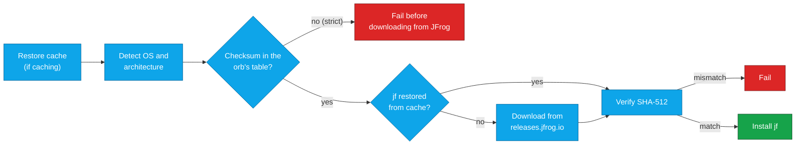

<div align="center">


# JFrog Orb for CircleCI

### The exact JFrog CLI you pinned, checksum-verified and on your `PATH`, with one line of YAML.

Install the [JFrog CLI](https://github.com/jfrog/jfrog-cli) (`jf`) and point it at your JFrog Platform with `configure` and `ping`,<br>
passing credentials by variable name, never by value.<br>
Strict SHA-512 verification by default · No `sudo` · amd64 and arm64 · Cached between runs

[](https://circleci.com/gh/juburr/jfrog-orb)
[](https://circleci.com/developer/orbs/orb/juburr/jfrog-orb)
[](LICENSE)
[](https://discuss.circleci.com/c/ecosystem/orbs)

[](#-checksum-verification)
[](#-supported-platforms)
[](#-checksum-verification)
[](#-secure-by-design)

**[Quick Start](#-quick-start)** · **[Features](#-why-jfrog-orb)** · **[Recipes](#-recipes)** · **[Connecting to JFrog](#-connecting-to-jfrog)** · **[Commands](#-commands)** · **[Security](#-secure-by-design)** · **[Network Access](#-network-access)**

<sub>An unofficial, community-maintained orb. [Contributions are welcome!](#-contributing)</sub>

</div>

<br>

## ✨ Why jfrog-orb?

<table>
<tr>
<td width="33%" valign="top">
📌 <b>Version pinned, cached</b><br><br>
Installs the <code>jf</code> release you name, never "latest". Upgrade when you decide to, not when JFrog ships. The verified binary is cached, keyed by version, architecture and home directory, so later runs skip the download.
</td>
<td width="33%" valign="top">
🔐 <b>Checksum verified</b><br><br>
Every binary, downloaded or restored from cache, is checked against a SHA-512 table in the orb. Unknown versions fail by default, before anything is downloaded. <a href="#-checksum-verification">Opt-outs</a> are explicit.
</td>
<td width="33%" valign="top">
🔑 <b>Credentials by name</b><br><br>
<code>configure</code> takes the <i>name</i> of the variable that holds your token, hands the secret to <code>jf</code> on stdin, and fails when <code>jf</code> would quietly save a profile with an empty token.
</td>
</tr>
<tr>
<td width="33%" valign="top">
🦾 <b>amd64 and arm64</b><br><br>
Detects the machine and installs the matching Linux build, including on CircleCI's <code>arm.*</code> resource classes.
</td>
<td width="33%" valign="top">
🔓 <b>No root needed</b><br><br>
Installs to <code>$HOME/bin</code> by default, creating it and adding it to <code>PATH</code> when it isn't already there.
</td>
<td width="33%" valign="top">
🧱 <b>Firewall friendly</b><br><br>
Every host <code>install</code>, <code>configure</code> and <code>ping</code> contact is <a href="#-network-access">documented</a>, for locked-down self-hosted runners. <code>configure</code> and <code>ping</code> skip <code>jf</code>'s version check against GitHub.
</td>
</tr>
</table>

Install scripts that fetch the latest `jf` on every run make CI change underneath you, and the breakage tends to show up on a Friday night. This orb installs the exact `jf` version you ask for, checks the binary against a SHA-512 checksum built into the orb, and caches it, so every run uses the same CLI.

When you want `jf` to talk to JFrog, `configure` writes a server profile from `JF_URL` and `JF_ACCESS_TOKEN`, and `ping` checks that Artifactory answers. Upload, build, and scan commands stay in your own steps, against the version `install` put on `PATH`.

> [!NOTE]
> JFrog publishes an official orb, [jfrog/artifactory-orb](https://circleci.com/developer/orbs/orb/jfrog/artifactory-orb). This one pins and verifies the `jf` binary, then offers `configure` and `ping` for the server profile. Upload, build, and scan stay as `jf` calls in your own steps.

## 🔄 How It Works



`jfrog-orb/install` downloads `jf` from JFrog's release host, or restores it from the CircleCI cache, verifies its SHA-512 checksum in the default `strict` mode shown here, and puts it on `PATH`. See [Checksum Verification](#-checksum-verification) for the other modes. `jfrog-orb/configure` writes a server profile from `JF_URL` and the token in `JF_ACCESS_TOKEN`, checks that `jf` really saved it, and makes it the default for later steps. `jfrog-orb/ping` checks that Artifactory answers. Everything after that is your own `jf` commands.

## 🚀 Quick Start

Add the orb and call `install` before any step that uses `jf`. Copy this into `.circleci/config.yml`:

```yaml
version: 2.1

orbs:
  jfrog-orb: juburr/jfrog-orb@0.2

jobs:
  publish:
    docker:
      - image: cimg/base:current
    steps:
      - checkout
      - jfrog-orb/install
      - run: jf --version

workflows:
  main:
    jobs:
      - publish
```

That's it. `jf` is on your `PATH`, verified, and cached for the next run. To point it at a JFrog Platform, add [`configure`](#-connecting-to-jfrog) and [`ping`](#pinging-artifactory) after `install`, as in [Connect to Artifactory and Upload a Build](#connect-to-artifactory-and-upload-a-build).

> [!TIP]
> Upgrading and passing `access_token: ${MY_TOKEN}` to `configure`? Its credential parameters now take the variable's name instead. See [Upgrading](#-upgrading).

> [!NOTE]
> In the default `strict` mode, `install` refuses `jf` releases its checksum table doesn't list (2.125.0 is the newest). See [Checksum Verification](#-checksum-verification).

## 🍳 Recipes

Each recipe assumes the orb is imported as `jfrog-orb`, as in the [Quick Start](#-quick-start).

### Pin a Specific `jf` Version

```yaml
steps:
  - jfrog-orb/install:
      version: "2.125.0"
```

### Connect to Artifactory and Upload a Build

Store `JF_URL` and `JF_ACCESS_TOKEN` in a [CircleCI context](https://circleci.com/docs/contexts/). `configure` reads those variables unless you pass `url`, or pass `access_token` with the name of another variable.

```yaml
jobs:
  upload:
    docker:
      - image: cimg/base:current
    steps:
      - checkout
      - jfrog-orb/install
      - jfrog-orb/configure
      - jfrog-orb/ping
      - run: jf rt upload "dist/*" my-generic-repo/

workflows:
  main:
    jobs:
      - upload:
          context: jfrog
```

### Add a Second Server

```yaml
- jfrog-orb/configure:
    server_id: deploy
    url: ${JF_DEPLOY_URL}           # a string, expanded
    access_token: JF_DEPLOY_TOKEN   # the name of the variable that holds the token
    set_default: false
```

`set_default: false` adds another server without making it the default: it skips `jf config use` and leaves `JFROG_CLI_SERVER_ID` alone. `jf` still marks the first server it saves as the default.

### Run on an arm64 Machine

No extra parameters. The orb sees `aarch64` and installs `jfrog-cli-linux-arm64`, verified against its own checksum, creating `install_path` and adding it to `PATH` if the machine image doesn't have it:

```yaml
jobs:
  build-arm:
    machine:
      image: ubuntu-2404:current
    resource_class: arm.medium
    steps:
      - jfrog-orb/install
      - run: jf --version
```

### Install Somewhere Else, or Skip the Cache

```yaml
steps:
  - jfrog-orb/install:
      install_path: /home/circleci/.local/bin  # absolute, created if needed, must be writable
      caching: false                           # always download, never touch the CircleCI cache
```

## 🔑 Connecting to JFrog

`configure` runs `jf config add`, then checks `jf config show`. Run it after `install`. The default server id is `jfrog-server`.

The credentials are never literal parameter values. `access_token`, `username`, and `password` take the **name** of an environment variable, such as one from a context: pass `access_token: JF_DEPLOY_TOKEN`, not `${JF_DEPLOY_TOKEN}`. They read `JF_ACCESS_TOKEN`, `JF_USER`, and `JF_PASSWORD` unless you name other variables. `url` and `artifactory_url` are not secrets, so they are strings expanded with `circleci env subst`; `url` defaults to `${JF_URL}`.

The token or password goes to `jf` on stdin. With `set_default: true` (the default), the command then runs `jf config use` and appends `JFROG_CLI_SERVER_ID` to `$BASH_ENV`, so later steps in the job do not need `--server-id`. To add a server that shouldn't become the default, see [Add a Second Server](#add-a-second-server).

> [!IMPORTANT]
> `jf config add` exits 0 when the token is empty and still writes the server. `configure` fails in that case. It also fails when the URL is missing, or when both a token and a password are set. If the variables named by `access_token` and `password` (`JF_ACCESS_TOKEN` and `JF_PASSWORD` by default) are both set in the job, unset the one this command should not use, or point its parameter at a variable that is not set.

`username` is optional next to an access token and required with a password. A reference token used by npm or Maven basic auth needs that username.

`url` is the platform URL, for example `https://acme.jfrog.io`. A value that ends in `/artifactory` is an Artifactory URL; the command warns and keeps going. For an Artifactory 6 server that does not share one platform URL, pass `artifactory_url` instead.

Password encryption is off (`encrypt_password: false`). Turning it on sends the password to Artifactory's encryption API. Leave it off unless `url` points at a platform you trust. Access tokens are stored as themselves either way. With it on, `configure` reads the saved password back and, if the endpoint returned a web page instead of a ciphertext, removes the profile and fails.

### Pinging Artifactory

`ping` runs `jf rt ping`. With no `server_id`, it uses `JFROG_CLI_SERVER_ID` from `configure`, then whatever server `jf` has marked as the default.

> [!NOTE]
> A successful ping means Artifactory answered. It does not prove permission to a repository. An anonymous Artifactory returns OK even when the token is wrong.

## 🧰 Commands

### `jfrog-orb/install`

Installs JFrog CLI (`jf`) for Linux on amd64 or arm64, matching the executor's CPU. In the default `strict` mode it verifies the SHA-512 checksum first and refuses versions it has no checksum for; see [Checksum Verification](#-checksum-verification) for the opt-outs. Run it before the orb's other commands. Needs bash 4 or newer and `curl` or `wget` on the executor.

| Parameter | Default | Description |
| --- | --- | --- |
| `version` | `2.125.0` | The `jf` version to install; a leading `v` is ignored. Values that aren't a release version, such as `latest`, are rejected. |
| `install_path` | *(empty)* | Absolute path of the directory to install `jf` into, writable without root. Empty means `$HOME/bin`. Created if needed, and added to `PATH` for later steps when it isn't already on it. A leading `~/` is expanded. |
| `verify_checksums` | `strict` | `strict`, `known_versions`, or `"false"` (not recommended). See [Checksum Verification](#-checksum-verification). |
| `caching` | `true` | Restore and save the `jf` binary with the CircleCI cache, keyed by version, CPU architecture and home directory. Only verified releases are cached, and a cached release is verified again before it is installed. |

### `jfrog-orb/configure`

Adds one JFrog server profile with `jf config add`, for later `jf` commands in the same job, and checks with `jf config show` that the URL and credential were saved. Needs `jf` from `install` on `PATH`. See [Connecting to JFrog](#-connecting-to-jfrog).

| Parameter | Default | Description |
| --- | --- | --- |
| `server_id` | `jfrog-server` | Server id to write. `jf` reserves `delete`, `use`, `show`, and `clear`. |
| `url` | `${JF_URL}` | Platform URL, for example `https://acme.jfrog.io`. Not an `/artifactory` URL. At least one of `url` and `artifactory_url` is required. |
| `artifactory_url` | *(empty)* | Artifactory URL for a server with no shared platform URL, such as Artifactory 6. |
| `access_token` | `JF_ACCESS_TOKEN` | *Name* of the environment variable that holds the access token (a reference token works too). The token is passed on stdin. |
| `username` | `JF_USER` | *Name* of the environment variable that holds the username. Optional next to a token. Required with a password. |
| `password` | `JF_PASSWORD` | *Name* of the environment variable that holds the password or API key, passed on stdin. Do not set both this variable and the one `access_token` names. |
| `overwrite` | `true` | Replace an existing profile with the same server id, so a rerun on a machine executor with a persisted home directory updates the token instead of failing. |
| `insecure_tls` | `false` | Pass `--insecure-tls` while saving this profile. Later commands do not inherit it. |
| `encrypt_password` | `false` | Ask Artifactory to encrypt the password. This sends the password to the platform. |
| `set_default` | `true` | Make this server the default: run `jf config use`, and export `JFROG_CLI_SERVER_ID` to `$BASH_ENV` for later steps. |

### `jfrog-orb/ping`

Pings Artifactory with `jf rt ping`, using this command's `server_id`, otherwise `JFROG_CLI_SERVER_ID` from `configure`, otherwise `jf`'s default server. Run `install` and `configure` first. The step fails with `jf`'s exit code when Artifactory doesn't answer.

| Parameter | Default | Description |
| --- | --- | --- |
| `server_id` | *(empty)* | Server id to ping. Empty uses `JFROG_CLI_SERVER_ID`, then `jf`'s default server. |
| `insecure_tls` | `false` | Pass `--insecure-tls` to this ping only. The saved server profile doesn't change. |

Environment variables are expanded in `install`'s `version` and `install_path`, in `configure`'s `server_id`, `url` and `artifactory_url`, and in `ping`'s `server_id`. `access_token`, `username` and `password` are variable names, used as given.

## 📦 Upgrading

### Unreleased: Configure Takes Credential Variable Names

> [!IMPORTANT]
> `configure`'s credential parameters now take the name of an environment variable instead of the secret, like the other juburr orbs. Pass `access_token: MY_TOKEN`, not `access_token: ${MY_TOKEN}` or the token itself. A `${...}` value now fails with an error that it is not a variable name.

| Old | New |
| --- | --- |
| `access_token` (string, default `${JF_ACCESS_TOKEN}`) | `access_token` (env_var_name, default `JF_ACCESS_TOKEN`) |
| `password` (string, default `${JF_PASSWORD}`) | `password` (env_var_name, default `JF_PASSWORD`) |
| `user` (string, default `${JF_USER}`) | `username` (env_var_name, default `JF_USER`) |
| `use` | `set_default` |

Pipelines that rely on the defaults (`JF_ACCESS_TOKEN`, `JF_USER`, `JF_PASSWORD`) need no change. `url` and `artifactory_url` are still strings expanded with `circleci env subst`.

### Unreleased: Messages on stderr

`configure` and `ping` now write their `ERROR:` and `WARN:` messages, and the `jf config show` output `configure` prints with an error, to stderr instead of stdout.

### v0.2.0: Configure and Ping

`configure` writes one `jf` server profile and checks that the token or password was actually saved. `ping` runs `jf rt ping`. Pipelines that only call `install` are unchanged.

### v0.2.0: arm64 Support

`install` now detects the machine architecture and installs `jfrog-cli-linux-arm64` on `aarch64` machines, verified against its own SHA-512 checksum. Every `jf` version in the checksum table (2.70.0 and later) has both amd64 and arm64 entries. Earlier releases installed the amd64 binary everywhere, which arm64 machines can't run natively. Other architectures and non-Linux machines now fail with an error instead of installing an amd64 binary. Cache keys now include the architecture, so the first run after upgrading downloads `jf` again.

### v0.2.0: Checksum Verification Fails Closed

`install` now defaults to `verify_checksums: strict`. If you install a `jf` version that this orb has no SHA-512 checksum for, the step fails instead of installing an unverified binary. Earlier releases defaulted to `known_versions`, which printed a warning and installed it anyway.

Pipelines that use the orb's default `jf` version, or any version in the checksum table, are unaffected. If you need a newer `jf` before the orb lists it, either upgrade the orb or opt out explicitly:

```yaml
- jfrog-orb/install:
    version: "2.130.0"
    verify_checksums: known_versions  # installs unlisted versions without verification
```

## 🔒 Secure by Design

- **Least Privilege**: Installs to a user-owned directory (`$HOME/bin` by default), with no `sudo` usage anywhere in this orb.
- **Integrity**: SHA-512 checksum validation of downloaded binaries, on by default and failing closed: a `jf` version this orb has no checksum for is refused, not installed unverified, and a binary that can't run on the executor never replaces an existing install. See [Checksum Verification](#-checksum-verification) for the `known_versions` and `"false"` opt-outs. `configure` doesn't trust `jf config add`'s exit code alone: it reads the profile back and fails when the URL or credential is missing.
- **Provenance**: Installs directly from JFrog's official release host, `releases.jfrog.io`, which serves the binary through its CDN, `releases-cdn.jfrog.io`. No third-party websites, domains, or proxies are used. JFrog doesn't sign the `jf` binaries, so each checksum in the orb's table comes from a download whose SHA-256 matched the checksum JFrog's Artifactory records for that file.
- **Confidentiality**: `access_token`, `username` and `password` take environment variable *names*, never literal values. The token or password reaches `jf` on stdin, never on its command line, and `configure` stops exporting the variables that hold them before it runs `jf`, so the secret isn't in `jf`'s environment either; later steps still see them. URLs are logged with any embedded credentials masked, `configure` and `ping` turn off xtrace, and `JFROG_CLI_SERVER_ID` is written to `$BASH_ENV` shell-quoted. Password encryption, which sends the password to Artifactory, is off unless you turn it on. All of this follows CircleCI's [security recommendations](https://circleci.com/docs/security-recommendations/) and [best practices](https://circleci.com/docs/orbs-best-practices/).
- **Privacy**: No usage data of any kind is collected or shipped back to the orb developer. `jf` itself is a separate matter: most `jf` commands check `api.github.com` for a newer release, which `configure` and `ping` turn off for their own steps (see [Network Access](#-network-access)), and `jf` can send usage statistics to the Artifactory server you configure. Set `JFROG_CLI_AVOID_NEW_VERSION_WARNING: "true"` and `JFROG_CLI_REPORT_USAGE: "false"` in the job's `environment` to turn both off for your own steps.

> [!IMPORTANT]
> **Info for security teams:** see [Network Access](#-network-access) for the hosts to allow on locked-down or self-hosted runners.

## 💻 Supported Platforms

| Platform | Supported | `jf` build installed |
| --- | :---: | --- |
| Linux `x86_64` | ✅ | `jfrog-cli-linux-amd64` |
| Linux `aarch64` | ✅ | `jfrog-cli-linux-arm64` |
| Other architectures, macOS, Windows | ❌ | Fails with an error instead of installing the wrong binary |

Linux executors on `x86_64` (amd64) and `aarch64`/`arm64` (arm64), including CircleCI [Arm resource classes](https://circleci.com/docs/using-arm/). The `install` command picks the `jf` build for the architecture reported by `uname -m` and, in the default `strict` mode, verifies it against that architecture's SHA-512 checksum. Any other operating system or architecture fails the install rather than installing a binary that can't run.

The download cache is keyed by `jf` version, executor architecture and home directory, so amd64 and arm64 jobs never share a cached binary. On executors whose `PATH` doesn't already include `install_path` (for example, machine executors), `install` adds it for later steps through `BASH_ENV`.

`install` needs bash 4 or newer, `mktemp`, and `curl` or `wget`, plus `sha512sum` when it verifies. `configure` and `ping` run under `/bin/bash` and need the CircleCI CLI (`circleci`) to expand their parameters, and `configure` with `encrypt_password: true` needs `base64`. CI runs `install` and `configure` on `cimg/base` (amd64) and on an `ubuntu-2404` machine with `arm.medium` (arm64), with `jf` 2.125.0 and 2.70.0, the newest and oldest versions in the table. `ping` needs a live Artifactory, so its tests run against a stubbed `jf`.

## 🔐 Checksum Verification



The `install` command checks the downloaded `jf` binary against a SHA-512 lookup table built into the orb, with one entry per `jf` version and architecture, including binaries restored from the CircleCI cache. The `verify_checksums` parameter controls what happens:

| Value | Version in the orb's table | Version not in the table |
| --- | --- | --- |
| `strict` (default) | ✅ Verified; install fails on mismatch | ⛔ Install fails before anything is downloaded |
| `known_versions` | ✅ Verified; install fails on mismatch | ⚠️ Installed **unverified**, with a warning |
| `"false"` | ⚠️ Not verified | ⚠️ Installed **unverified** |

The table lists every `jf` release from 2.70.0 through 2.125.0, the default `version`, on both architectures. Each entry comes from a `releases.jfrog.io` download whose SHA-256 matched the checksum Artifactory records for that file. If you pin a `jf` release newer than this orb, `strict` fails until the orb is upgraded. Upgrade the orb (or [contribute the checksum](#-contributing)) rather than opting out. Use `known_versions` only as a temporary opt-out, for cases where you accept running an unverified binary.

> [!WARNING]
> **Changed in v0.2.0:** the default was previously `known_versions`, which installed unlisted versions without verification. Pipelines that pin a `jf` version newer than the orb's table now fail until they upgrade the orb or set `verify_checksums: known_versions` explicitly.

## 🌐 Network Access

Hosts to allow (HTTPS, port 443) when running on a locked-down or self-hosted runner:

| Host | Needed by | Purpose |
| --- | --- | --- |
| `releases.jfrog.io` | `install` | `jf` release downloads, from `https://releases.jfrog.io/artifactory/jfrog-cli/v2-jf/<version>/jfrog-cli-linux-<arch>/jf` |
| `releases-cdn.jfrog.io` | `install` | `releases.jfrog.io` answers every download with an HTTP 302 redirect to a signed URL on this CDN host, which serves the binary. Allowing `releases.jfrog.io` alone is not enough. |
| CircleCI's cache storage | `install` with `caching: true` (the default) | The built-in `restore_cache` and `save_cache` steps. On CircleCI cloud with self-hosted runners, that requires outbound HTTPS to `circleci-tasks-prod.s3.us-east-1.amazonaws.com` (see the [runner FAQ](https://circleci.com/docs/guides/execution-runner/runner-faqs/#what-connectivity-is-required)). On CircleCI server, caches go to your installation's own object storage instead. Set `caching: false` to avoid cache traffic entirely. |
| Your JFrog Platform or Artifactory | `ping`; `configure` only with `encrypt_password: true` | `ping` runs `jf rt ping` against the configured server. `encrypt_password: true` sends the password in a `GET` to `<artifactory-url>/api/security/encryptedPassword`. |

Nothing else:
- `install` runs the installed `jf --version` once, with `JFROG_CLI_AVOID_NEW_VERSION_WARNING=true`, to check that the binary works on the machine. That command makes no network requests.
- With an access token, or with a password when `encrypt_password` is false (the default), `configure` does not contact the JFrog Platform. It writes the server profile under `~/.jfrog/`.
- `configure` and `ping` set `JFROG_CLI_AVOID_NEW_VERSION_WARNING=true` for their own step only, so they do not call `api.github.com`.

Running `jf` in your own steps (upload, build info, scan, and anything past `ping`) needs more:

| Host | Used for | Notes |
| --- | --- | --- |
| The JFrog Platform or Artifactory URLs you configure | Your `jf` commands | Required for whatever those commands do |
| `api.github.com` | `jf`'s check for a newer CLI release, at `https://api.github.com/repos/jfrog/jfrog-cli/releases/latest` | Optional. Most `jf` commands make this check. `jf` records it in its home directory and repeats it every 6 hours, so on a fresh CI machine it happens once per job. If the check is blocked, `jf` prints a warning and carries on. Set `JFROG_CLI_AVOID_NEW_VERSION_WARNING=true` to turn it off; later steps do not inherit it from `configure` or `ping`. |

## 🤝 Contributing

This is an unofficial, community-maintained orb, and contributions are welcome! Bug reports, feature ideas and pull requests all help.

- **Found a bug or have an idea?** [Open an issue](https://github.com/juburr/jfrog-orb/issues).
- **Need a newer `jf` release?** New releases need a checksum entry before `strict` mode will install them. Generate its checksums with `src/scripts/install_hash.sh -v <version>`, paste them into the `sha512sums` table in [`src/scripts/install.sh`](src/scripts/install.sh), and open a pull request. The script checks each download against the SHA-256 that Artifactory recorded before printing its SHA-512, for both architectures, and needs `curl` and `jq`.
- **Before opening a pull request**, run the checks CI runs. The tests stub `jf` and downloads, so they need no network access. Run them in a UTF-8 locale: `test/configure_test.sh` fails under `LC_ALL=C`.

  ```bash
  yamllint .
  shellcheck src/scripts/*.sh test/*.sh
  for t in test/*_test.sh; do bash "$t" || break; done
  circleci orb pack src > orb.yml && circleci orb validate orb.yml
  ```

## 🎨 Logo

Need the logo for a slide deck, blog post, or internal developer portal? PNGs with transparent backgrounds are in [`assets/logos`](assets/logos): [64](assets/logos/jfrog-orb-64px.png) · [128](assets/logos/jfrog-orb-128px.png) · [256](assets/logos/jfrog-orb-256px.png) · [512](assets/logos/jfrog-orb-512px.png) · [1024](assets/logos/jfrog-orb-1024px.png) px

## 📜 License

[MIT](LICENSE) © 2025-2026 Justin Burr

<br>

<div align="center">
  
  <br>
  <sub>Same <code>jf</code>, every run. If this orb helps your team, a ⭐ helps others find it.</sub>
  <br>
  <sub><a href="#jfrog-orb-for-circleci">Back to top ↑</a></sub>
</div>
