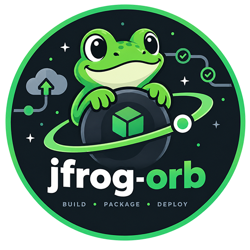
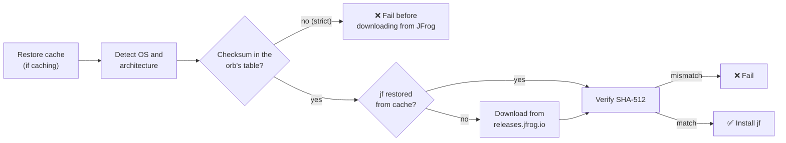

<div align="center">



# CircleCI JFrog Orb

**Install a pinned, checksum-verified JFrog CLI (`jf`) in your CircleCI pipelines with one line of YAML.**

[](https://circleci.com/gh/juburr/jfrog-orb)
[](https://circleci.com/developer/orbs/orb/juburr/jfrog-orb)
[](https://github.com/juburr/jfrog-orb/blob/main/LICENSE)
[](https://discuss.circleci.com/c/ecosystem/orbs)
<br>
[](#-checksum-verification)
[](#supported-platforms)
[](#-parameters)

[Quick start](#-quick-start) •
[Examples](#-examples) •
[Configure](#-configure) •
[Ping](#-ping) •
[Parameters](#-parameters) •
[Checksums](#-checksum-verification) •
[Security teams](#-info-for-security-teams) •
[Upgrade notes](#-upgrade-notes)

</div>

---

Install scripts that fetch the latest `jf` on every run make CI change underneath you, and the breakage tends to show up on a Friday night. This unofficial orb installs the exact `jf` version you ask for, checks the binary against a SHA-512 checksum built into the orb, and caches it, so every run uses the same CLI.

When you want `jf` to talk to JFrog, `configure` writes a server profile from `JF_URL` and `JF_ACCESS_TOKEN`, and `ping` checks that Artifactory answers. Upload, build, and scan commands stay in your own steps, against the version `install` put on `PATH`.

> [!NOTE]
> JFrog publishes an official orb, [jfrog/artifactory-orb](https://circleci.com/developer/orbs/orb/jfrog/artifactory-orb). This one pins and verifies the `jf` binary, then offers `configure` and `ping` for the server profile. Upload, build, and scan stay as `jf` calls in your own steps.

## ✨ Why this orb?

<table>
  <tr>
    <td width="33%" valign="top">
      <h3>📌 Version pinned</h3>
      Installs the <code>jf</code> release you name, never "latest". Upgrade when you decide to, not when JFrog ships.
    </td>
    <td width="33%" valign="top">
      <h3>🔐 Checksum verified</h3>
      Every binary, downloaded or restored from cache, is checked against a SHA-512 table in the orb. Unknown versions fail by default.
    </td>
    <td width="33%" valign="top">
      <h3>⚡ Cached</h3>
      The binary is stored in the CircleCI cache, keyed by version, architecture and home directory, so later runs skip the download.
    </td>
  </tr>
  <tr>
    <td width="33%" valign="top">
      <h3>🦾 amd64 and arm64</h3>
      Detects the machine and installs the matching Linux build, including on CircleCI's <code>arm.*</code> resource classes.
    </td>
    <td width="33%" valign="top">
      <h3>🔓 No root needed</h3>
      Installs to <code>$HOME/bin</code> by default, creating it and adding it to <code>PATH</code> when it isn't already there.
    </td>
    <td width="33%" valign="top">
      <h3>🧱 Firewall friendly</h3>
      Every host <code>install</code>, <code>configure</code>, and <code>ping</code> contact is <a href="#required-external-access">documented</a>, for locked-down self-hosted runners.
    </td>
  </tr>
</table>

## 🚀 Quick start

Add the orb and call `install` before any step that uses `jf`:

```yaml
version: 2.1

orbs:
  jfrog-orb: juburr/jfrog-orb@0.2

jobs:
  publish:
    docker:
      - image: cimg/base:current
    steps:
      - checkout
      - jfrog-orb/install
      - run: jf --version

workflows:
  main:
    jobs:
      - publish
```

That's it. `jf` is on your `PATH`, verified, and cached for the next run. To point it at a JFrog Platform, add [`configure`](#-configure) and [`ping`](#-ping) after `install`.

## 📚 Examples

<details open>
<summary><b>Pin a specific <code>jf</code> version</b></summary>

```yaml
steps:
  - jfrog-orb/install:
      version: "2.125.0"
```

</details>

<details>
<summary><b>Connect to Artifactory and upload a build</b></summary>

Store `JF_URL` and `JF_ACCESS_TOKEN` in a [CircleCI context](https://circleci.com/docs/contexts/). `configure` reads those names unless you pass `url` and `access_token`.

```yaml
jobs:
  upload:
    docker:
      - image: cimg/base:current
    steps:
      - checkout
      - jfrog-orb/install
      - jfrog-orb/configure
      - jfrog-orb/ping
      - run: jf rt upload "dist/*" my-generic-repo/

workflows:
  main:
    jobs:
      - upload:
          context: jfrog
```

</details>

<details>
<summary><b>Run on an arm64 machine</b></summary>

No extra parameters. The orb sees `aarch64` and installs `jfrog-cli-linux-arm64`, verified against its own checksum, creating `install_path` and adding it to `PATH` if the machine image doesn't have it:

```yaml
jobs:
  build-arm:
    machine:
      image: ubuntu-2404:current
    resource_class: arm.medium
    steps:
      - jfrog-orb/install
      - run: jf --version
```

</details>

<details>
<summary><b>Install somewhere else, or skip the cache</b></summary>

```yaml
steps:
  - jfrog-orb/install:
      install_path: /home/circleci/.local/bin  # absolute, created if needed, must be writable
      caching: false                           # always download, never touch the CircleCI cache
```

</details>

## 🔑 Configure

`configure` runs `jf config add`, then checks `jf config show`. Run it after `install`. The default server id is `jfrog-server`. It reads `JF_URL`, `JF_ACCESS_TOKEN`, `JF_USER`, and `JF_PASSWORD` from the job environment unless you pass those parameters. Values are expanded with `circleci env subst`, which is what makes `${JF_URL}` work.

The token or password goes to `jf` on stdin. On success the command runs `jf config use` and appends `JFROG_CLI_SERVER_ID` to `$BASH_ENV`, so later steps in the job do not need `--server-id`.

> [!IMPORTANT]
> `jf config add` exits 0 when the token is empty and still writes the server. `configure` fails in that case. It also fails when the URL is missing, or when both a token and a password are set. If `JF_ACCESS_TOKEN` and `JF_PASSWORD` are both set in the job, unset the one this command should not use.

`user` is optional next to an access token and required with a password. A reference token used by npm or Maven basic auth needs that username.

`url` is the platform URL, for example `https://acme.jfrog.io`. A value that ends in `/artifactory` is an Artifactory URL; the command warns and keeps going. For an Artifactory 6 server that does not share one platform URL, pass `artifactory_url` instead.

Password encryption is off (`encrypt_password: false`). Turning it on sends the password to Artifactory's encryption API. Leave it off unless `url` points at a platform you trust. Access tokens are stored as themselves either way.

```yaml
- jfrog-orb/configure:
    server_id: deploy
    url: ${JF_DEPLOY_URL}
    access_token: ${JF_DEPLOY_TOKEN}
    use: false
```

`use: false` adds another server without making it the default. `jf` still marks the first server it saves as the default.

## 🏓 Ping

`ping` runs `jf rt ping`. With no `server_id`, it uses `JFROG_CLI_SERVER_ID` from `configure`, then whatever server `jf` has marked as the default.

> [!NOTE]
> A successful ping means Artifactory answered. It does not prove permission to a repository. An anonymous Artifactory returns OK even when the token is wrong.

## 🔧 Parameters

The orb has three commands: `install`, `configure`, and `ping`.

### `install`

| Parameter | Type | Default | Description |
| --- | --- | --- | --- |
| `version` | string | `2.125.0` | The `jf` version to install. |
| `verify_checksums` | enum | `strict` | `strict`, `known_versions`, or `"false"`. See [Checksum verification](#-checksum-verification). |
| `install_path` | string | `$HOME/bin` | Absolute directory to install `jf` into, created if needed and added to `PATH` when it isn't already there. Pick one that doesn't need root. |
| `caching` | boolean | `true` | Restore and save the `jf` binary with the CircleCI cache. |

### `configure`

| Parameter | Type | Default | Description |
| --- | --- | --- | --- |
| `server_id` | string | `jfrog-server` | Server id to write. `jf` reserves `delete`, `use`, `show`, and `clear`. |
| `url` | string | `${JF_URL}` | Platform URL, for example `https://acme.jfrog.io`. Not an `/artifactory` URL. |
| `artifactory_url` | string | `""` | Artifactory URL for a server with no shared platform URL, such as Artifactory 6. |
| `access_token` | string | `${JF_ACCESS_TOKEN}` | Access token, including a reference token, passed on stdin. |
| `user` | string | `${JF_USER}` | Optional next to a token. Required with a password. |
| `password` | string | `${JF_PASSWORD}` | Password or API key, passed on stdin. Do not set this with `access_token`. |
| `overwrite` | boolean | `true` | Replace an existing profile with the same server id. |
| `insecure_tls` | boolean | `false` | Pass `--insecure-tls` while saving this profile. Later commands do not inherit it. |
| `encrypt_password` | boolean | `false` | Ask Artifactory to encrypt the password. This sends the password to the platform. |
| `use` | boolean | `true` | Run `jf config use` and export `JFROG_CLI_SERVER_ID` for later steps. |

### `ping`

| Parameter | Type | Default | Description |
| --- | --- | --- | --- |
| `server_id` | string | `""` | Server id to ping. Empty uses `JFROG_CLI_SERVER_ID`, then `jf`'s default server. |
| `insecure_tls` | boolean | `false` | Pass `--insecure-tls` to this ping only. |

### Supported platforms

| Platform | Supported | `jf` build installed |
| --- | :---: | --- |
| Linux `x86_64` | ✅ | `jfrog-cli-linux-amd64` |
| Linux `aarch64` | ✅ | `jfrog-cli-linux-arm64` |
| Other architectures, macOS, Windows | ❌ | Fails with an error instead of installing the wrong binary |

The checksum table lists every `jf` release from 2.70.0 through 2.125.0, the default `version`, on both architectures. Newer releases fail in `strict` mode until the orb adds their checksums (see [Contributing](#-contributing)).

## 🔐 Checksum verification



`install` downloads the Linux build of `jf` that matches the machine (`x86_64` → `jfrog-cli-linux-amd64`, `aarch64` → `jfrog-cli-linux-arm64`); other architectures and non-Linux machines fail with an error. It checks the SHA-512 checksum of the binary against a lookup table built into this orb, keyed by version and architecture, including binaries restored from the CircleCI cache. The `verify_checksums` parameter controls what happens when the requested `version` is missing from that table:

| `verify_checksums` | Listed version | Unlisted version |
| --- | --- | --- |
| `strict` (default) | ✅ Verified | ❌ Fails before downloading from JFrog |
| `known_versions` | ✅ Verified | ⚠️ Installed **unverified**, with a warning |
| `"false"` | ⚠️ Not verified | ⚠️ Not verified (not recommended) |

> [!TIP]
> If you pin a `jf` release newer than this orb knows about, upgrade the orb or [contribute the checksum](#-contributing). Use `known_versions` only as a temporary opt-out.

## 🧱 Info for Security Teams

### Required external access

Hosts to allow if you run a locked-down, self-hosted CircleCI pipeline on-prem:

- **Installing `jf`** (`install`):
  - `releases.jfrog.io`: `jf` release downloads, from `https://releases.jfrog.io/artifactory/jfrog-cli/v2-jf/<version>/jfrog-cli-linux-<arch>/jf`.
  - `releases-cdn.jfrog.io`: `releases.jfrog.io` answers every download with an HTTP 302 redirect to a signed URL on this CDN host, which serves the binary. Allowing `releases.jfrog.io` alone is not enough.
  - With `caching` enabled (the default), `install` also uses CircleCI's cache storage through the built-in `restore_cache` and `save_cache` steps. On CircleCI cloud with self-hosted runners, that requires outbound HTTPS to `circleci-tasks-prod.s3.us-east-1.amazonaws.com` (see the [runner FAQ](https://circleci.com/docs/guides/execution-runner/runner-faqs/#what-connectivity-is-required)). On CircleCI server, caches go to your installation's own object storage instead. Set `caching: false` to avoid cache traffic entirely.
  - Nothing else. `install` runs the installed `jf --version` once, with `JFROG_CLI_AVOID_NEW_VERSION_WARNING=true`, to check that the binary works on the machine. That command makes no network requests, so none of the hosts below are contacted during installation.
- **Configuring `jf`** (`configure`):
  - With an access token, or with a password when `encrypt_password` is false (the default), this step does not contact the JFrog Platform. It writes the server profile under `~/.jfrog/`.
  - `encrypt_password: true` sends the password in a `GET` to `<artifactory-url>/api/security/encryptedPassword`.
  - `configure` sets `JFROG_CLI_AVOID_NEW_VERSION_WARNING=true` for that step only, so it does not call `api.github.com`.
- **Pinging Artifactory** (`ping`):
  - Contacts the configured Artifactory server (`jf rt ping`).
  - Also sets `JFROG_CLI_AVOID_NEW_VERSION_WARNING=true` for that step only.
- **Running `jf` in your own steps** (upload, build info, scan, and anything past `ping`):
  - The JFrog Platform or Artifactory URLs you configure `jf` to use.
  - `api.github.com`: most `jf` commands check `https://api.github.com/repos/jfrog/jfrog-cli/releases/latest` for a newer CLI release. `jf` records the check in its home directory and repeats it every 6 hours, so on a fresh CI machine it happens once per job. If the check is blocked, `jf` prints a warning and carries on. Set `JFROG_CLI_AVOID_NEW_VERSION_WARNING=true` to turn it off. `configure` and `ping` set that variable for their own step; later steps do not inherit it.

## 📦 Upgrade Notes

### v0.2.0: configure and ping

`configure` writes one `jf` server profile and checks that the token or password was actually saved. `ping` runs `jf rt ping`. Pipelines that only call `install` are unchanged.

### v0.2.0: arm64 support

`install` now detects the machine architecture and installs `jfrog-cli-linux-arm64` on `aarch64` machines, verified against its own SHA-512 checksum. Every `jf` version in the checksum table (2.70.0 and later) has both amd64 and arm64 entries. Earlier releases installed the amd64 binary everywhere, which arm64 machines can't run natively. Other architectures and non-Linux machines now fail with an error instead of installing an amd64 binary. Cache keys now include the architecture, so the first run after upgrading downloads `jf` again.

### v0.2.0: checksum verification fails closed

> [!IMPORTANT]
> `install` now defaults to `verify_checksums: strict`. If you install a `jf` version that this orb has no SHA-512 checksum for, the step fails instead of installing an unverified binary. Earlier releases defaulted to `known_versions`, which printed a warning and installed it anyway.

Pipelines that use the orb's default `jf` version, or any version in the checksum table, are unaffected. If you need a newer `jf` before the orb lists it, either upgrade the orb or opt out explicitly:

```yaml
- jfrog-orb/install:
    version: "2.130.0"
    verify_checksums: known_versions  # installs unlisted versions without verification
```

## 🤝 Contributing

New `jf` releases need a checksum entry before `strict` mode will install them. To add one:

1. Generate entries for both architectures. The script checks each download against the SHA-256 that Artifactory recorded before printing its SHA-512. It needs `curl` and `jq`.
   ```bash
   bash src/scripts/install_hash.sh -v 2.130.0
   ```
2. Paste the output into the `sha512sums` table in [`src/scripts/install.sh`](src/scripts/install.sh).
3. Run the tests. Downloads are stubbed, so no network access is needed.
   ```bash
   bash test/install_test.sh
   ```
4. Open a pull request.

Issues and feature requests are welcome in [GitHub Issues](https://github.com/juburr/jfrog-orb/issues).

## 📄 License

[MIT](LICENSE) © Justin Burr
