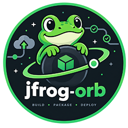

  
  <h1>CircleCI JFrog Orb</h1>
  <i>A CircleCI orb for streamlining JFrog CLI intallation and use.</i>  

   

This unofficial JFrog CLI orb facilitates the installation and execution of the JFrog CLI tool (`jf`) within CircleCI pipelines. An official JFrog Artifactory orb can be found at: [jfrog/artifactory-orb](https://circleci.com/developer/orbs/orb/jfrog/artifactory-orb). This one differs in its ability to provide version locking of the `jf` tool, providing more stable and consistent CI environment that won't break on a Friday night. This avoids install scripts that greedily fetch the latest version every time.

## Info for Security Teams

### Required external access

Hosts to allow if you run a locked-down, self-hosted CircleCI pipeline on-prem:

- **Installing `jf`** (`install`):
  - `releases.jfrog.io`: `jf` release downloads, from `https://releases.jfrog.io/artifactory/jfrog-cli/v2-jf/<version>/jfrog-cli-linux-<arch>/jf`.
  - `releases-cdn.jfrog.io`: `releases.jfrog.io` answers every download with an HTTP 302 redirect to a signed URL on this CDN host, which serves the binary. Allowing `releases.jfrog.io` alone is not enough.
  - With `caching` enabled (the default), `install` also uses CircleCI's cache storage through the built-in `restore_cache` and `save_cache` steps. On CircleCI cloud with self-hosted runners, that requires outbound HTTPS to `circleci-tasks-prod.s3.us-east-1.amazonaws.com` (see the [runner FAQ](https://circleci.com/docs/guides/execution-runner/runner-faqs/#what-connectivity-is-required)). On CircleCI server, caches go to your installation's own object storage instead. Set `caching: false` to avoid cache traffic entirely.
  - Nothing else. In particular, `install` never runs `jf`, so none of the hosts below are contacted during installation.
- **Running `jf` in your own steps** (the orb doesn't do this, but your firewall will see it):
  - The JFrog Platform or Artifactory URLs you configure `jf` to use.
  - `api.github.com`: most `jf` commands check `https://api.github.com/repos/jfrog/jfrog-cli/releases/latest` for a newer CLI release. `jf` records the check in its home directory and repeats it every 6 hours, so on a fresh CI machine it happens once per job. If the check is blocked, `jf` prints a warning and carries on. Set `JFROG_CLI_AVOID_NEW_VERSION_WARNING=true` to turn it off.
